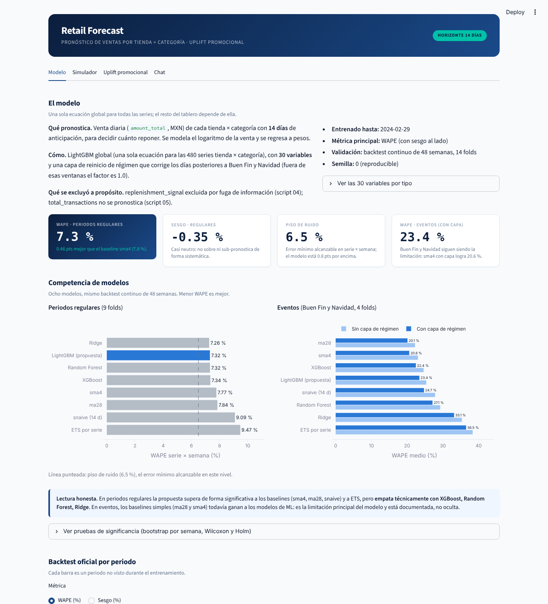
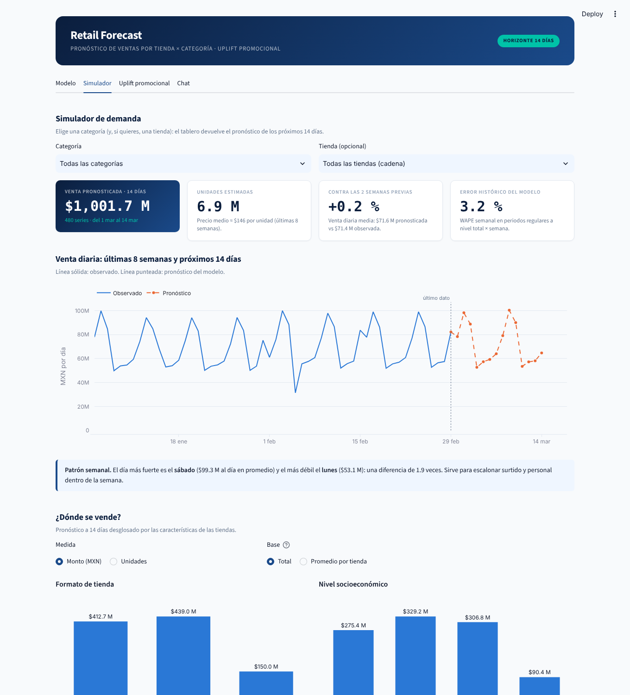
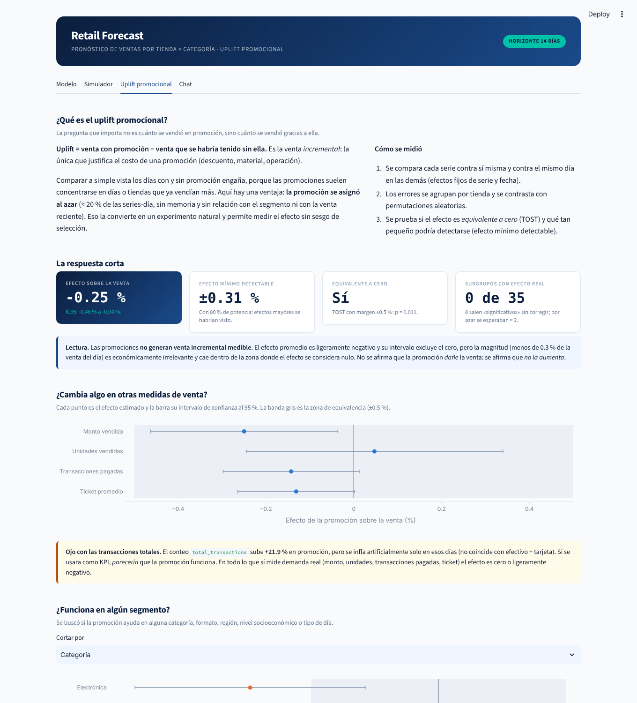
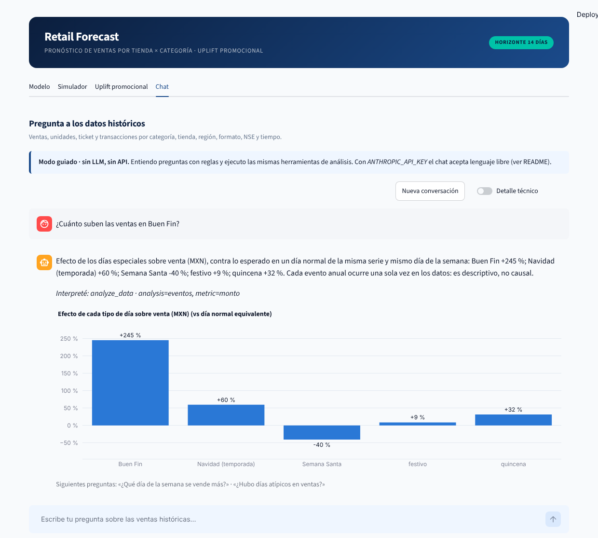

# Retail Forecast · Prueba técnica de Data Scientist

**Pronóstico de ventas por tienda × categoría a 14 días y medición del efecto real de las promociones, para una cadena retail en México.**
Este README sigue el orden en que conviene revisar el proyecto: primero qué se pidió y qué se propone, después el dashboard para verlo funcionando
y, al final, toda la solución técnica.

| | |
|---|---|
| [1 · La evaluación y la propuesta](#1--la-evaluación-y-la-propuesta) | qué se pide y qué se responde |
| [2 · El dashboard](#2--el-dashboard-véalo-primero) | cómo ejecutarlo en 3 comandos y qué ver en cada pestaña |
| [3 · La solución completa](#3--la-solución-completa) | resultados, hallazgos, pipeline, decisiones y limitaciones |

---

## 1 · La evaluación y la propuesta

### Qué se pide

Una prueba técnica abierta ([enunciado](docs/ENUNCIADO.md); diccionario de datos en [`data/data_dictionary.md`](data/data_dictionary.md)): se entrega un histórico de operaciones de una cadena retail (`transactions`, `stores` y `calendar`) y
**el candidato define el problema de negocio, el enfoque, cómo validarlo y qué métricas demuestran su valor.** Se entrega un repositorio público, **funcional y reproducible**, con un
[`PROCESS.md`](PROCESS.md) que documente el proceso y el uso de herramientas de AI.

### Qué se propone

| Decisión | Respuesta |
|---|---|
| **Problema de negocio** | Cuánto reponer en cada tienda y categoría con **14 días de anticipación** (Capa 1: pronóstico) y si las promociones **realmente venden más** (Capa 2: uplift) |
| **Datos** | 80 tiendas × 6 categorías × 425 días (2023-01-01 → 2024-02-29): 204 000 filas |
| **Enfoque** | Un LightGBM global (30 variables, sin fugas de información) más una capa que corrige los días posteriores a Buen Fin y Navidad. Se compara contra 7 modelos y baselines |
| **Cómo se valida** | Backtest *walk-forward* de 48 semanas y 14 folds; reglas de aceptación fijadas **antes** de ver resultados; pruebas de significancia |
| **Métrica** | WAPE en tienda × categoría × semana (la unidad de la decisión de reposición), con el sesgo al lado |
| **Resultado** | WAPE **7.3 %** en periodos regulares, a 0.8 pts del piso de ruido (6.5 %); supera a los baselines pero **empata** con Ridge, Random Forest y XGBoost. Las promociones **no generan venta incremental** (−0.25 %, IC95 −0.46 a −0.04 %, acotado a ±0.5 %) |
| **Lo que no funciona (y se dice)** | En Buen Fin y Navidad los baselines simples le ganan al ML (K2 no se cumple); hay una sola ocurrencia de cada evento |

> La propuesta completa, con cifras, hallazgos de datos y limitaciones, está en la [sección 3](#3--la-solución-completa).

---

## 2 · El dashboard (véalo primero)

Un tablero en [Streamlit](https://streamlit.io) que muestra el modelo entrenado, simula demanda, explica el uplift y permite preguntar a los datos.
**No reentrena nada ni exige una llave de API**: lee el modelo y la evidencia que ya están en el repositorio.

### Así se ve

**1 · Modelo** — métricas globales, competencia de modelos y lectura honesta de resultados.



**2 · Simulador** — pronóstico de los próximos 14 días por categoría y, opcionalmente, por tienda.



**3 · Uplift promocional** — qué es, cómo se midió, qué resultó y qué acciones detona.



**4 · Chat (opcional)** — preguntas sobre el histórico con gráficas, con o sin API.



### Ejecutarlo

**Requisitos previos**

- [`uv`](https://docs.astral.sh/uv/getting-started/installation/) (gestor de entornos; instala solo el Python 3.12 que fija `.python-version`) y `git`.
- Nada más: sin GPU, sin llaves de API, sin datos externos, sin correr el pipeline. Después de instalar las dependencias funciona sin conexión.

```bash
git clone https://github.com/MarcosAxity/retail-forecast.git && cd retail-forecast
uv sync                              # entorno exacto desde uv.lock
uv run streamlit run app.py          # abre http://localhost:8501
```

La primera carga tarda unos segundos mientras se arma el panel de datos; luego todo responde al instante.

<details>
<summary><b>Opciones de ejecución</b> (puerto, chat, solución de problemas)</summary>

```bash
uv run streamlit run app.py --server.port 8502             # si el 8501 está ocupado
uv run streamlit run app.py -- --chat offline              # chat guiado sin LLM (valor por defecto sin llave)
uv run streamlit run app.py -- --chat off                  # oculta la pestaña Chat
uv run streamlit run app.py -- --chat claude               # chat con Claude (requiere llave, ver abajo)
```

| `--chat` | Comportamiento |
|---|---|
| `auto` (por defecto) | Claude si hay una `ANTHROPIC_API_KEY` válida; si no, modo guiado sin LLM |
| `offline` | Modo guiado: reglas + las mismas herramientas de análisis. Sin red, sin llave |
| `claude` | Lenguaje libre con Claude. Sin llave válida avisa y cae al modo guiado |
| `off` | Quita la pestaña Chat |

También se puede fijar con la variable `CHAT_MODE`. Si algo falla: `uv sync` de nuevo (el entorno debe ser Python 3.12) y `uv run pytest tests/test_dashboard.py tests/test_chat.py` para comprobar el entorno.

</details>

### Qué hace cada pestaña

**1 · Modelo** — qué pronostica, cómo, y qué tan bien: KPI de WAPE, sesgo, piso de ruido; la competencia de 8 modelos en periodos regulares y en eventos
con una «lectura honesta» (el modelo empata con Ridge/RF/XGBoost y pierde contra baselines en eventos); backtest por periodo; importancia de variables (ganancia o SHAP) y error por segmento.

**2 · Simulador** — se elige una **categoría** (y opcionalmente una **tienda**) y devuelve el pronóstico de los 14 días siguientes al último dato (1–14 de marzo de 2024): venta, unidades estimadas,
comparación contra las 2 semanas previas, error histórico del modelo para esa selección, el desglose por formato, NSE, región y categoría, y la tabla por tienda con **descarga en CSV**.


**3 · Uplift promocional** — qué es el uplift, cómo se midió (efectos fijos, aleatorización, equivalencia), la respuesta corta (**−0.25 %**, equivalente a cero), el aviso sobre el artefacto de `total_transactions`,
la búsqueda de segmentos (0 de 35 con efecto real tras corrección), si la promoción adelanta o roba ventas de otros días y una calculadora de punto de equilibrio con márgenes ajustables. Cierra con **qué acciones detona** el resultado.


**4 · Chat (opcional)** — preguntas sobre las transacciones históricas con gráficas: rankings, evolución, efecto de Buen Fin/Navidad/quincena, crecimiento interanual, anomalías, comparaciones y promoción.
Dos modos con las mismas herramientas: **guiado** (sin LLM, funciona al clonar el repo) y **Claude** (lenguaje libre). En ambos las cifras salen de pandas, nunca del modelo de lenguaje; el interruptor «Detalle técnico» muestra qué consulta se ejecutó.


<details>
<summary><b>Activar el chat con Claude</b> (opcional)</summary>

```bash
uv sync --extra chat                 # instala el SDK de Anthropic
cp .env.example .env                 # y escribe tu ANTHROPIC_API_KEY en .env (no se versiona)
uv run streamlit run app.py          # modo auto: detecta la llave y activa Claude
```

El modelo se cambia con `CLAUDE_MODEL` en `.env`. Claude llama a las herramientas del tablero (máx. 6 pasos por pregunta); si la API falla, la pestaña responde en modo guiado.

</details>

### De dónde salen los números del dashboard

Todo se lee de `artifacts/` y `outputs/` (versionados) y de `data/raw/`; las cifras son las mismas del pipeline. El pronóstico del simulador viene de `outputs/13_pronostico_proximos_14_dias/`
y, si faltara, se recalcula con el modelo guardado. Las unidades son una **estimación** (monto ÷ precio unitario reciente): el modelo pronostica monto. El histórico no trae SKU, por eso el simulador trabaja por categoría y tienda.

---

## 3 · La solución completa

### Resultados en una página

| Tema | Resultado |
|---|---|
| Modelo final | LightGBM global (30 features, objetivo L2 sobre log del monto) + capa de reinicio de régimen tras Buen Fin y Navidad |
| Periodos regulares (9 folds) | WAPE **7.3 %** (serie × semana) contra 7.8 % de `sma4`, 7.8 % de `ma28`, 9.1 % de `snaive` y 9.5 % de ETS |
| Competidores de ML | Ridge 7.26 %, Random Forest 7.32 %, XGBoost 7.34 %: empate técnico con la propuesta; no se afirma que sea «el mejor» |
| Eventos (Buen Fin, Navidad) | Los baselines `ma28` y `sma4` superan a los modelos de ML; es la limitación principal y está documentada |
| Piso de ruido | 15.6 % (serie × día) · 6.5 % (serie × semana) · 3.4 % (tienda × semana) · 2.1 % (total): el modelo está cerca del mínimo alcanzable |
| Uplift promocional | Efecto sobre el monto de **−0.25 %** (IC95 −0.46 a −0.04 %): sin venta incremental; acotado dentro de ±0.5 % |

Las cifras salen de `outputs/` y se regeneran con el pipeline. Al fijar las versiones de las librerías (`xgboost` no estaba declarado
en `pyproject.toml`) Random Forest y XGBoost difieren ≈ 0.01 pt de lo documentado antes en periodos regulares; en post-Navidad XGBoost
con capa queda en 12.0 % (antes 13.1 %), así que la propuesta pasa del 3.º al 4.º puesto de 8. Las conclusiones no cambian: K1 se cumple y K2 no.

### Hallazgos de datos que condicionan el diseño

El análisis completo, con evidencia y decisiones, está en [`docs/EDA.md`](docs/EDA.md) (documento único del EDA). Resumen:

1. **`replenishment_signal` es fuga de información.** Es el promedio de `total_transactions` en la ventana [t−5, t+1] (coincide en 99.76 % de las filas) y la demanda del día objetivo se reconstruye con error < 0.5 transacciones en el 99.7 % de los casos. Se excluye (script 04).
2. **`total_transactions` está inflado ≈ 22 % solo en días con promoción** y no coincide con efectivo + tarjeta; no mide demanda. El target es `amount_total` (script 05).
3. **La promoción se asignó al azar** (≈ 20 % por serie-día, sin memoria, sin relación con segmento ni con la venta reciente): es un experimento natural y permite estimar uplift sin sesgo de selección (script 03).
4. **Los nulos son fallas puntuales independientes (MCAR)**: 5.9 % de efectivo, 3.0 % de unidades, 2.4 % de ticket (script 02).
5. **El nivel lo explica el formato de tienda** (R² = 0.78; 0.89 con todos los atributos); la **dinámica** la dominan Buen Fin (×2.7–3.4 el nivel base) y Navidad (script 03).
6. **El ruido irreducible fija el techo de precisión** (σ residual ≈ 0.20 en log, sin autocorrelación): ver tabla de pisos arriba.

### Cómo reproducirlo

Requisitos: [uv](https://docs.astral.sh/uv/) y Python 3.12 (se fija en `.python-version`; `uv` lo instala solo).

```bash
git clone <este repositorio> && cd retail-forecast
uv sync                                   # entorno exacto desde uv.lock
uv run python run_pipeline.py             # pipeline completo (≈ 6–10 min en 4 núcleos)
uv run pytest                             # 70 pruebas (incluye anti-fuga temporal, pronóstico, dashboard y chat)
uv run streamlit run app.py               # dashboard sobre los resultados regenerados
```

Los datos originales están en `data/raw/`. Todo lo aleatorio usa semilla fija. No hace falta correr el pipeline para ver el dashboard: los resultados ya están en `artifacts/` y `outputs/`.

```bash
uv run python run_pipeline.py --list              # pasos, entradas y salidas, sin ejecutar
uv run python run_pipeline.py --only 11           # un paso
uv run python run_pipeline.py --from 07 --to 10   # un tramo
uv run python run_pipeline.py --skip 10           # todo menos la competencia de modelos (el paso más lento)
uv run python scripts/11_uplift_promocional.py    # o ejecutar un script directamente
```

### Orden de ejecución

Cada paso es un script de `scripts/` (sin notebooks). Cada uno escribe `log.txt`, `tabla_XX.csv` y `fig_XX.png`
en `outputs/<paso>/`, en el mismo orden en que aparecen en el script. `run_pipeline.py` registra el estado y
la duración de cada paso en `outputs/pipeline_run.json`.

| Paso | Script | Qué hace | Lee | Escribe |
|---|---|---|---|---|
| 00 | `00_preparar_datos` | Panel maestro, features h=14 y baselines | `data/raw/` | `data/processed/`, `outputs/reports/baselines_h14.csv` |
| 01 | `01_eda_calidad_y_dinamica` | EDA 1/3: estructura, calidad, segmentos, dinámica temporal, promociones | `data/raw/` | `outputs/01_*/` |
| 02 | `02_eda_nulos_consistencias_calendario` | EDA 2/3: nulos (¿MCAR?), consistencias, calendario, extremos | `data/raw/` | `outputs/02_*/` |
| 03 | `03_eda_tiendas_promocion_ruido` | EDA 3/3: atributos de tienda, asignación aleatoria de promociones, piso de ruido | `data/raw/` | `outputs/03_*/` |
| 04 | `04_auditoria_replenishment` | Auditoría de fuga de información de `replenishment_signal` | `data/raw/` | `outputs/04_*/` |
| 05 | `05_definicion_target` | Monto vs. unidades vs. transacciones como target | `data/raw/` | `outputs/05_*/` |
| 06 | `06_features_y_baselines` | Features anti-fuga, esquema de validación, baselines | `data/raw/` | `outputs/06_*/` |
| 07 | `07_modelado_lightgbm` | Backtest, ablaciones, hiperparámetros, SHAP | `data/processed/` | `outputs/07_*/`, `configs/model_params.json` |
| 08 | `08_backtest_oficial_y_modelo_final` | Backtest oficial (8 folds) y modelo final | `configs/` | `outputs/reports/`, `outputs/models/` |
| 09 | `09_modelado_eventos` | Reinicio de régimen y target multiplicativo (backtest continuo de 48 semanas) | `outputs/reports/` | `outputs/09_*/` |
| 10 | `10_comparacion_modelos` | Competencia de 8 modelos, significancia y argumentación de la métrica | `outputs/reports/` | `outputs/10_*/` |
| 11 | `11_uplift_promocional` | Uplift promocional: efectos fijos, aleatorización, heterogeneidad, dinámica | `data/processed/` | `outputs/11_*/` |
| 12 | `12_exportar_artifacts` | Reúne el modelo y su evidencia con manifiesto de integridad | `outputs/`, `configs/` | `artifacts/` |
| 13 | `13_pronostico_proximos_14_dias` | Pronóstico de los 14 días siguientes al último dato (alimenta el simulador del dashboard) | `artifacts/model/`, `data/raw/` | `outputs/13_*/` |

Los pasos 01–06 dependen solo de los datos; 07 → 08 → (09, 10) deben ir en ese orden porque 09 y 10 reutilizan las
predicciones del backtest oficial y verifican que se reproducen (diferencia 0.0 MXN).

### Carpeta de artifacts

`artifacts/` contiene lo necesario para auditar y reutilizar el modelo (`manifest.json` lista el sha256 de cada archivo):

```
artifacts/
  model/        lgbm_h14.joblib · model_spec.json (features, hiperparámetros, capa de régimen, protocolo) · feature_importance.csv
  metrics/      backtest_metrics_h14.csv · baselines_h14.csv · comparacion_regulares.csv · comparacion_eventos.csv
                significancia_vs_competidores.csv · uplift_resumen.json
  environment/  versions.txt · data_fingerprint.json   (el entorno exacto está en uv.lock)
  manifest.json
```

### Estructura del repositorio

```
app.py           entrada del dashboard       src/dashboard/    pestañas, gráficos y chat del dashboard
data/raw/        datos originales            data/processed/   generado (no versionado)
scripts/         pasos del pipeline          src/              lógica reutilizable (data, features, models, dashboard)
outputs/         salidas por paso            artifacts/        modelo y evidencia exportados
configs/         hiperparámetros elegidos    tests/            pruebas (anti-fuga, backtest, regímenes, dashboard, chat)
docs/            EDA.md e imágenes           notebooks/        versión exploratoria original (los scripts son la fuente de verdad)
.streamlit/      tema del dashboard          .env.example      variables del chat opcional con Claude
```

Correspondencia notebook → script: `01_eda` → 01 · `02_eda_complementario` → 02 y 03 · `03_auditoria_replenishment_signal` → 04 ·
`04_definicion_del_target` → 05 · `05_features_y_baselines` → 06 · `06_modelado` → 07 · `06b_modelado_eventos` → 09 · `07_comparacion_modelos` → 10.

### Métricas

Todas las métricas se calculan **sobre el backtest walk-forward** (el modelo predice periodos que no vio al entrenar) y solo con filas que tienen venta real y pronóstico.
La definición vive en `src/models/evaluate.py`; el nivel de agregación, en `src/models/backtest.py`.

| Métrica | Fórmula | Cómo leerla | Papel en el proyecto |
|---|---|---|---|
| **WAPE** | Σ\|y − ŷ\| / Σy | «De cada 100 pesos de venta real, cuántos se planearon mal». 7.3 % = el pronóstico se desvía 7.3 % de la venta | **Métrica principal** (criterios K1/K2, competencia de modelos, dashboard) |
| **Sesgo** | Σ(ŷ − y) / Σy | Positivo: sobrepronóstico (exceso de inventario). Negativo: subpronóstico (riesgo de faltante) | **Siempre al lado del WAPE**: el WAPE no dice en qué dirección se falla |
| **MAE** | media de \|y − ŷ\| | Error medio en MXN | Apoyo: da la escala monetaria; no es comparable entre niveles de agregación |
| **MAPE** | media de \|y − ŷ\| / y | Error porcentual promedio, fila por fila | **Solo secundaria** y para contrastar con WAPE (ver «Por qué WAPE y no MAPE») |
| **WAPE asimétrico** | Σ(2·faltante + sobrante) / Σy | WAPE donde quedarse corto pesa el doble | Prueba de robustez: no hay costos reales de negocio, así que no se usa para ajustar el modelo |
| **Piso de ruido** | WAPE mínimo alcanzable dado el ruido irreducible de las ventas (paso 03) | El mejor WAPE que cualquier modelo podría lograr | Techo de lo exigible: ≈ 6.5 % a serie × semana, ≈ 15.6 % a serie × día |
| **Habilidad vs `sma4`** | WAPE del modelo − WAPE del promedio móvil de 4 semanas (en puntos) | Cuántos puntos mejora el modelo al baseline simple | El listón real a superar |

**Nivel de agregación.** El error se mide sumando primero y comparando después. La unidad de decisión (la reposición semanal) es **tienda × categoría × semana**
(`serie × semana`): se suman 7 días de venta real y de pronóstico de cada serie y sobre esas sumas se calcula el error. Solo cuentan semanas completas (7 días).
También se reporta por tienda × semana, categoría × semana y total × semana; mientras más se agrega, más se cancela el ruido y menor es el error.
A nivel diario (serie × día) el piso de ruido ya es ≈ 15.6 %, por eso no se usa para evaluar.

**Validación.** Folds fijados antes de mirar resultados: desarrollo, confirmación y evento (Buen Fin, Navidad y post-evento).
Un cambio al modelo se adopta solo si mejora ≥ 0.2 pt de WAPE en desarrollo. Los periodos regulares y los de evento se reportan por separado, porque se comportan distinto.

**Dónde verlo.** Cifras globales y por fold: pestaña **Modelo** del dashboard y `artifacts/metrics/`. Argumentación completa y pruebas empíricas: `scripts/10_comparacion_modelos.py`
(secciones 6.1–6.3) y `outputs/10_comparacion_modelos/log.txt`. Origen de la meta y del piso de ruido: `docs/EDA.md`, sección «Implicaciones para las métricas».

### Selección de variables

El modelo final usa **30 variables** (lista en `artifacts/model/model_spec.json`). No salen de un método automático (RFE, Boruta o selección por importancia), sino de tres capas de decisión
con una regla fijada antes de mirar resultados.

**1 · Se decide por diseño qué puede entrar (scripts 04 a 06).**
- **Se excluye `replenishment_signal`** por fuga de información: coincide al 99.76 % con un promedio que incluye el día a pronosticar.
- **No se usan `month`, `quarter`, `week_of_year` ni `store_id`:** con 14 meses de datos cada valor aparece una o dos veces y el modelo los usaría como índice de tiempo en lugar de aprender el patrón.
- **De los atributos de tienda solo entran formato y nivel socioeconómico;** el nivel propio de cada tienda ya lo capturan sus rezagos.
- **Todo lo derivado de la demanda usa información con al menos 14 días de antigüedad** (el horizonte), y `tests/test_features.py` lo comprueba perturbando el futuro.

**2 · Se prueba por ablación qué se agrega o se quita (script 07, sección 2).** Cada variante se compara contra la base de 30 variables y **se adopta solo si mejora el WAPE de desarrollo al menos 0.2 puntos**.
La columna de confirmación son folds que no se usaron para decidir.

| Variante | Δ WAPE desarrollo (pts) | Δ WAPE confirmación (pts) | Decisión |
|---|---|---|---|
| + `month` y `week_of_year` | −0.14 | −0.24 | No adoptar (bajo el umbral y funcionaría como índice temporal) |
| + atributos extra de tienda (región, m², cajas, farmacia, gasolinera, año) | +0.04 | −0.04 | No adoptar |
| − promoción (`has_promotion`, `promo_share_28`) | −0.01 | −0.03 | No adoptar: no aporta y es coherente con el uplift ≈ 0 |
| − distancias de calendario (solo banderas) | +0.14 | +0.16 | No adoptar: quitarlas empeora |
| − variables de Buen Fin y Navidad | +0.15 | +1.03 | No adoptar: quitarlas empeora, sobre todo en confirmación |
| + rezagos que excluyen días de evento | +0.16 | +0.94 | No adoptar: empeora |
| Objetivo L1 en log (mediana) | +0.07 | +0.08 | No adoptar |
| Objetivo Huber en log | 0.00 | −0.01 | No adoptar |

Ninguna variante superó el umbral, por lo que el modelo de referencia se queda con sus 30 variables. Un valor positivo significa que el error sube.

**3 · El propio modelo atenúa lo poco útil.** LightGBM usa `colsample_bytree = 0.8`, `subsample = 0.8` y `min_child_samples = 100`, que reducen el peso de variables redundantes (los rezagos y los promedios móviles están muy correlacionados).
La importancia por ganancia y por SHAP está en la pestaña **Modelo**: `same_dow_mean` aporta 55 % y `lag_14d` 21 %.

**Qué no se hizo y por qué.** No se aplicó selección automática: con 30 variables, un árbol que ya ignora las inútiles y mejoras máximas de 0.14 pts en las ablaciones, el beneficio esperado es menor que el riesgo de sobreajustar
la selección a 14 folds. Una cautela abierta: las variables de distancia a Buen Fin y Navidad suman ≈ 8 % de importancia SHAP y, como cada evento aparece una sola vez en el entrenamiento,
podrían estar memorizando esa única ocurrencia (misma limitación que la primera viñeta de «Limitaciones»).

### Decisiones metodológicas

#### Por qué WAPE y no MAPE (con ejemplos)

**La pregunta que contesta la métrica.** Reponer inventario es una decisión semanal por tienda y categoría. Lo que le importa al negocio es *cuántos pesos de venta se planearon mal*.
Eso es exactamente WAPE: el error total dividido entre la venta total. MAPE contesta otra pregunta: «¿cuál fue el error porcentual promedio de cada fila?».
Cuando todas las filas pesan igual de poco o de mucho las dos coinciden; en retail casi nunca es así.

**Problema 1 · MAPE trata igual una tienda chica que una grande.**

| | Venta real | Pronóstico | Error | Error % |
|---|---|---|---|---|
| Supercenter | $100,000 | $90,000 | $10,000 | 10 % |
| Express | $1,000 | $2,000 | $1,000 | 100 % |

- **MAPE** = (10 % + 100 %) / 2 = **55 %**. Una tienda que vende el 1 % del total decide la métrica.
- **WAPE** = $11,000 / $101,000 = **10.9 %**. Cada peso de venta pesa lo mismo: refleja la operación real.

Con 480 series de tamaños muy distintos (Express, Bodega, Supercenter) y días con muy poca venta, MAPE se vuelve inestable; con una venta de cero ni siquiera está definido.

**Problema 2 · MAPE premia pronosticar de menos.** Imagina un producto que un día vende 50 unidades y al siguiente 150.

| Pronóstico | MAPE | WAPE | Sesgo |
|---|---|---|---|
| 100 (el promedio, sin sesgo) | (50 % + 33 %) / 2 = **41.7 %** | 100 / 200 = **50 %** | 0 % |
| 50 (la mitad del promedio) | (0 % + 67 %) / 2 = **33.3 %** | 100 / 200 = **50 %** | −50 % |

Un modelo que *siempre se queda corto* parece 8 puntos «mejor» con MAPE, aunque dejaría sin producto al cliente el día de 150. El motivo: el error de un subpronóstico
nunca puede pasar de 100 % de la venta (pronosticar 0), pero el de un sobrepronóstico no tiene tope. WAPE da el mismo valor en los dos casos, así que no recompensa el truco,
y el sesgo (−50 %) lo deja a la vista. En inventario ese truco se traduce en **faltantes y ventas perdidas** que MAPE esconde.

**Comprobación con los datos del proyecto** (script 10, sección 6.2): se tomó el LightGBM final y se le aplicó un sesgo a propósito, multiplicando todo su pronóstico por un factor.

| Factor | Sesgo | WAPE | MAPE |
|---|---|---|---|
| × 0.90 (10 % de menos) | −10.3 % | 11.41 | **10.79** |
| × 1.00 (modelo real) | −0.3 % | 7.31 | 7.26 |
| × 1.10 (10 % de más) | +9.6 % | 11.15 | **11.78** |

Con el mismo tamaño de error, MAPE da una nota casi 1 punto mejor al modelo que se queda corto que al que se pasa (10.8 contra 11.8), mientras que WAPE los califica casi igual (11.4 contra 11.2).
Esa diferencia es puro artefacto de la métrica, no de la calidad del pronóstico.

**Por qué no las demás.**
- **MAE y RMSE** dependen de la escala en pesos: las series grandes los dominan y no se pueden comparar entre niveles de agregación (serie, tienda, total). RMSE además se dispara con los picos de Buen Fin y Navidad.
- **sMAPE** corrige solo en parte la asimetría y sigue sin ponderar por volumen.
- **R²** se infla por la diferencia de escala entre series (0.97 incluso con baselines flojos) y no distingue entre modelos.
- **MASE/RMSSE** necesitan una escala de referencia por serie; el cociente entre el WAPE del modelo y el de `sma4` da la misma lectura sin ese costo.

**Qué no se afirma.** En estos datos la métrica **no cambia el ranking de modelos**: WAPE, MAE y RMSE ordenan igual a los 8 modelos (correlación de Spearman 1.00) y MAPE solo intercambia posiciones entre los empatados.
WAPE se elige por interpretación (porcentaje de venta mal planeada), comparabilidad entre niveles y falta de escala; no porque cambie la conclusión.

**Por qué el sesgo va al lado.** WAPE es simétrico y no dice en qué dirección se falla, pero el sesgo solo también engaña: en eventos, ETS tiene el menor sesgo absoluto (2.8 %) y el peor WAPE (38.3 %) porque sus errores positivos y negativos se cancelan.
Se reportan juntos. Y como quedarse corto cuesta distinto que pasarse, el WAPE asimétrico (faltante ×2) sirve de prueba de robustez y es el argumento para construir cuantiles p10/p90.

#### Objeciones razonables a WAPE y cómo se atienden

WAPE tampoco es una métrica perfecta. Estas son las objeciones que más se le hacen y qué responde el proyecto a cada una.

1. **«Al ponderar por volumen, ignora lo de poco volumen aunque sea estratégico.»** Es cierto como propiedad de la métrica: un error en una serie pequeña casi no mueve el WAPE global.
   Aquí pesa menos por dos razones. La decisión que se evalúa es la reposición, y ahí lo que cuenta son los pesos de venta mal planeados; y los datos no traen SKU ni margen, así que no hay productos nuevos
   ni categorías de alto margen que priorizar. Además el WAPE no se reporta solo como un número global: se desglosa por categoría, formato de tienda y región
   (`outputs/07_modelado_lightgbm/tabla_06.csv` y pestaña **Modelo**), donde el WAPE va de 7.3 % a 7.9 % en los 14 segmentos, sin ninguno rezagado.
   Si el negocio contara con márgenes o con una lista de series estratégicas, bastaría ponderar el error por ese criterio en lugar de por venta (misma fórmula, otros pesos).
2. **«WAPE no detecta sesgos sistemáticos: los errores pueden compensarse.»** Por eso el sesgo (Σ(ŷ − y) / Σy) se reporta **siempre al lado** y no en su lugar. Además se reporta **por segmento**, que es donde se descubre la compensación
   entre categorías sobreestimadas y subestimadas: en los 14 segmentos de `tabla_06.csv` el sesgo no pasa de ±1 % (máximo 0.94 %). Donde sí hay un sesgo importante se dice abiertamente:
   en eventos el modelo subpronostica el pico (≈ −17 % en promedio en los folds de evento) y eso es lo que justifica los cuantiles p10/p90 pendientes (ver «Limitaciones»).
3. **«Un WAPE no es comparable entre periodos con volúmenes distintos (temporadas, inflación).»** Es cierto, y por eso **nunca se compara el WAPE de periodos distintos por sí solo**. Los periodos regulares y los de evento
   (Buen Fin, Navidad, post-Navidad) se reportan por separado, y en cada fold el modelo se compara contra el baseline `sma4` **en ese mismo periodo**: la lectura es «cuántos puntos mejora a un baseline simple en las mismas fechas»,
   no «el WAPE es 15 % y por tanto es bueno». El piso de ruido por nivel de agregación sirve de referencia adicional sobre qué error es alcanzable. La inflación casi no influye a un horizonte de 14 días.

#### Otras decisiones

- **Validación:** walk-forward con corte = inicio del fold − horizonte (14 días). Los folds de desarrollo, de
  confirmación y de evento se fijaron antes de mirar resultados; un cambio se adopta solo si mejora ≥ 0.2 pt en desarrollo.
- **Criterios de aceptación fijados antes de ejecutar:** K1 (regulares) se cumple; K2 (top 2 en post-evento) **no** se cumple.
- **Uplift** (script 11): contraste con efectos fijos de serie y de fecha (el diseño es aleatorio), errores agrupados por
  tienda, prueba de aleatorización por permutaciones, equivalencia (TOST), efecto mínimo detectable, heterogeneidad con
  corrección de Benjamini-Hochberg, event study de ±7 días y días consecutivos de promoción.

### Limitaciones

- Una sola ocurrencia de Buen Fin y Navidad: las ventanas de la capa de régimen son hipótesis y no pueden validarse hasta ver un segundo año.
- En eventos, los baselines simples superan al ML; la política híbrida (baseline limpio con alerta en eventos y ML fuera de ellos) queda como trabajo futuro.
- El dataset no trae costos, descuentos ni márgenes de las promociones: el análisis de uplift mide venta, no rentabilidad (la tabla de punto de equilibrio usa márgenes ilustrativos).
- **Pendiente · cuantiles p10/p90 (rango de incertidumbre).** Hoy el modelo entrega un solo número por día y serie (el valor esperado). Los cuantiles darían además un rango:
  el **p10** es un valor por debajo del cual la venta real cae solo el 10 % de las veces y el **p90** uno por encima del cual cae solo el 10 %; entre los dos queda el 80 % de los casos.
  Por ejemplo, «se esperan $200,000 y lo más probable es que estén entre $170,000 y $240,000». Sirven para decidir cuánto inventario de seguridad llevar, porque cubrirse contra un faltante
  (usar un valor cercano al p90) cuesta distinto que cubrirse contra un exceso (usar uno cercano al p10). Son sobre todo necesarios en eventos: el modelo subpronostica el pico del Buen Fin (≈ −59 %)
  y la rampa navideña (≈ −20 % y −32 %), y sin cuantiles ese riesgo de faltante no queda cuantificado. Se evaluarían con pérdida *pinball* y cobertura (que el 80 % real caiga dentro del rango), no con WAPE.
- **Pendiente · ensamble Ridge + LightGBM.** Un ensamble promedia (o pondera) los pronósticos de dos modelos. En los periodos regulares Ridge (un modelo lineal, simple y muy rápido) y LightGBM (árboles de decisión) empatan
  (WAPE 7.26 % y 7.31 %) y Ridge gana a LightGBM en la mayoría de las semanas regulares. Como son modelos de naturaleza distinta, sus errores no coinciden del todo y combinarlos podría bajar el error de los dos.
  Falta probarlo en el backtest con la misma validación; no se asume que mejore. Hasta entonces se usa LightGBM porque en los folds de evento es claramente mejor que Ridge (WAPE medio 25.4 % contra 35.3 % sin capa de régimen) y es el modelo que ya lleva la capa de régimen.

Proceso de trabajo y uso de herramientas de AI: ver [`PROCESS.md`](PROCESS.md).
