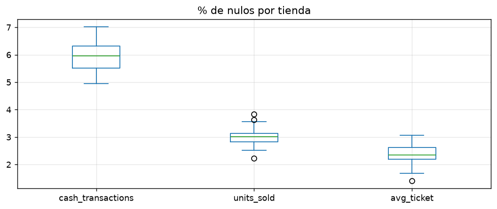
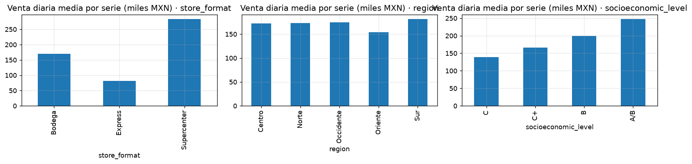
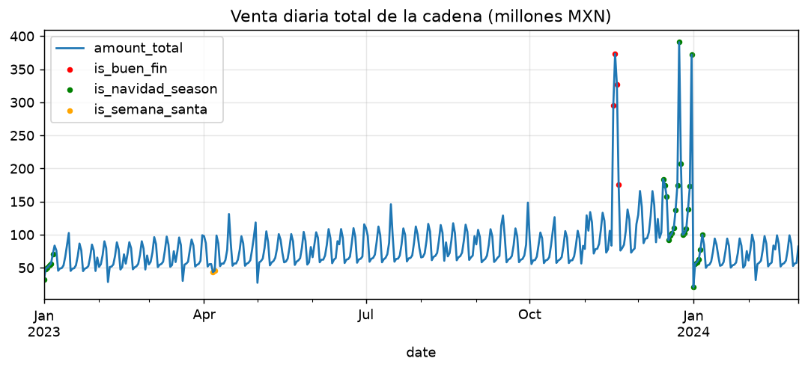
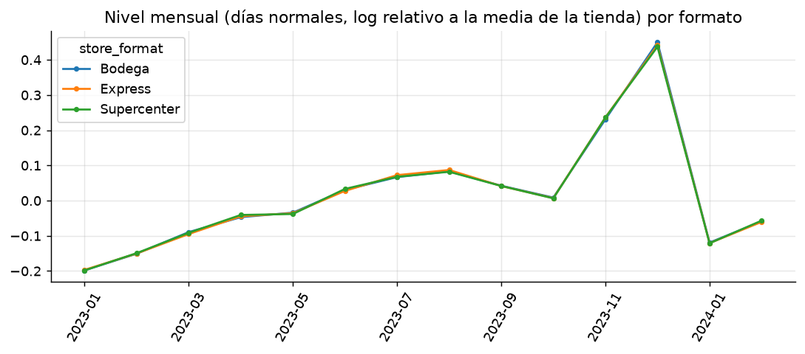
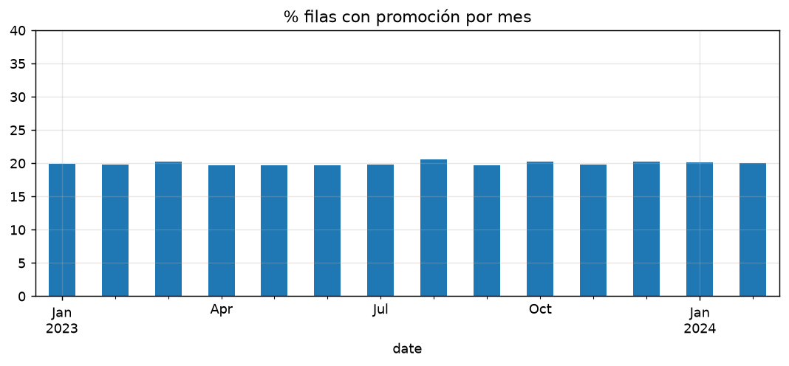
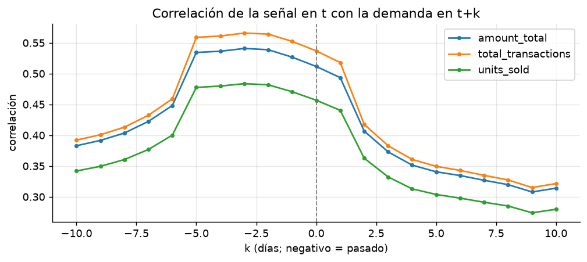
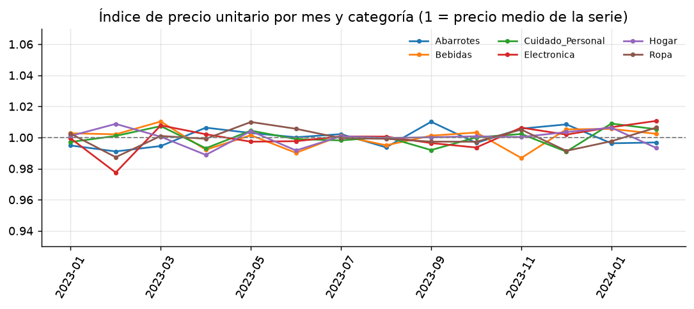

# Análisis exploratorio (EDA): qué dicen los datos y qué decisiones se derivan

Documento único del EDA. Cada hallazgo indica su **evidencia** (cifra y script que la produce) y la **decisión** que cambia en el modelado.
Las cifras se regeneran con `uv run python run_pipeline.py --from 01 --to 06`; las tablas y figuras están en `outputs/<paso>/`.

| Sección | Script | Salidas |
|---|---|---|
| 1. Estructura y completitud · 4. Segmentos · 5. Dinámica temporal · 6. Promociones (patrón) | `01_eda_calidad_y_dinamica` | `outputs/01_*/` |
| 2. Nulos · 3. Consistencias, calendario y extremos | `02_eda_nulos_consistencias_calendario` | `outputs/02_*/` |
| 4. Atributos de tienda · 6. Promociones (aleatoriedad) · 9. Ruido irreducible | `03_eda_tiendas_promocion_ruido` | `outputs/03_*/` |
| 7. `replenishment_signal` | `04_auditoria_replenishment` | `outputs/04_*/` |
| 8. Elección del target | `05_definicion_target` | `outputs/05_*/` |

## 0. Los siete hallazgos que más cambian el modelado

1. **`replenishment_signal` es fuga de información.** Es exactamente el promedio de `total_transactions` en la ventana [t−5, t+1] (99.76 % de coincidencia): incluye el día a pronosticar y el siguiente. Se excluye con cualquier rezago.
2. **`total_transactions` está inflado ≈ 22 % solo en días con promoción** (en 100 % de esas filas no coincide con efectivo + tarjeta, y en 0 % de las demás). No mide demanda; el target y el uplift se miden sobre `amount_total`.
3. **La promoción se comporta como un experimento aleatorizado** (Bernoulli ≈ 0.20 por serie-día, sin memoria, sin relación con segmento ni con la venta reciente). Permite medir uplift sin sesgo de selección.
4. **Dos eventos dominan la dinámica y ocurren una sola vez**: Buen Fin (la semana del evento vende 2.4× el nivel de septiembre) y Navidad (hasta 2.2×), seguidos de una caída en enero (0.82–0.87×). Ningún modelo puede aprender su magnitud con una sola ocurrencia: se evalúan aparte.
5. **El nivel de cada tienda lo explica el formato** (R² = 0.78; 0.89 con todos los atributos); el resto de atributos es el formato disfrazado. Un modelo global con formato y nivel socioeconómico basta.
6. **El ruido irreducible fija el techo de precisión**: σ ≈ 0.20 en logaritmos, sin autocorrelación. Ni un pronóstico perfecto baja de WAPE ≈ 15.6 % a serie × día, ≈ 6.5 % a serie × semana, ≈ 3.4 % a tienda × semana y ≈ 2 % a categoría o total. La meta se mide en serie × semana.
7. **Los nulos son fallas puntuales independientes (MCAR)** y la calidad general es alta (42 filas ausentes de 204 000; sin ceros, duplicados ni valores implausibles); los extremos son eventos reales, no errores.

---

## 1. Estructura y completitud

- 80 tiendas × 6 categorías × 425 días (2023-01-01 → 2024-02-29) = **480 series** y 204 000 filas en la malla completa; se observan 203 958.
- **42 filas ausentes** (0.02 %), todas en 3 tiendas y de 2 o 3 días seguidos: STR_045 (1–2 feb 2023), STR_064 (22–23 feb 2023) y STR_055 (18–20 feb 2024). No hay periodos largos sin datos.

**Decisión.** No se imputan: la malla se completa con la bandera `is_missing_row` y esas filas quedan fuera del entrenamiento y de las métricas. Imputar el target crearía datos que el modelo aprendería e inflaría las métricas.

## 2. Nulos: ¿aleatorios o estructurados?

| Columna | % nulos | Observación |
|---|---|---|
| `amount_total`, `amount_card`, `card_transactions`, `total_transactions` | 0 | completas |
| `cash_transactions` y `amount_cash` | 5.94 | siempre nulas **juntas** (una sola falla del registro de efectivo) |
| `units_sold` | 3.00 | casi independiente del efectivo (349 coincidencias de 6 118) |
| `avg_ticket` | 2.39 | los 4 874 nulos caen todos en filas con efectivo nulo (40 % de ellas) |
| `replenishment_signal` | 0.47 | solo los dos primeros días del periodo (el diccionario dice que son los últimos) |

**Evidencia de que son MCAR (script 02):**
- La tasa de nulos de efectivo es ≈ uniforme entre segmentos (5.6 %–6.4 % entre categoría, formato, región, nivel socioeconómico, promoción, festivo, día de la semana y mes).
- La dispersión entre tiendas es la esperable por azar (0.55 pp observado vs. 0.47 pp esperado; |z| máx. = 2.3).
- Un nulo ayer no eleva la probabilidad hoy (5.7 % vs. 6.0 %) y no hay tienda-semana con efectivo 100 % nulo (0 de 4 960): son fallas puntuales, no apagones.

**Decisión.** Las columnas con nulos describen el mismo día que se pronostica, así que no existen al predecir: se conservan con `NaN` y bandera, y no se usan como features. El target (`amount_total`) no tiene nulos.

## 3. Consistencias, calendario y valores extremos

**Consistencia entre monto, transacciones y ticket**
- `amount_total` = efectivo + tarjeta de forma exacta (diferencia máxima 3.5 × 10⁻¹⁰ MXN): el target es confiable.
- `avg_ticket` coincide siempre con `amount_total` / (efectivo + tarjeta). Monto, ticket y transacciones pagadas son coherentes entre sí.
- **`total_transactions` es la excepción**: difiere de efectivo + tarjeta **si y solo si** `has_promotion = 1` (en 38 295 de 38 295 filas con promoción verificables y en 0 de 153 540 sin ella), con un exceso de 8 % a 35 % (media 22 %). Hipótesis, no verificable con estos datos: en días con promoción se cuentan transacciones sin monto asociado (cupones de valor cero o conteos duplicados).

**Calendario** (5 de 5 reglas verificables se cumplen)
- `is_holiday` también marca los 4 días del Buen Fin → el preprocesamiento crea `is_official_holiday`, que los excluye.
- `is_semana_santa` solo marca Jueves y Viernes Santo de 2023; la Semana Santa de 2024 cae fuera del periodo, así que no se modela.

**Valores extremos = demanda real**
- El 98.3 % de las filas con venta > 3× su mediana de 28 días cae en Buen Fin, Nochebuena, Navidad o Fin de Año. Las caídas (< 0.3×) son sobre todo el 1-ene-2024 (449 de 532).
- Residuos extremos (|residuo| > 1 en log): 22.5 % de las filas en días de evento contra 0.10 % en días normales.
- Sin ceros (mínimo 6 922 MXN), sin duplicados, sin montos congelados; unidades por transacción entre 0.9 y 2.8.

**Decisión.** Los extremos no se recortan ni se eliminan: se modelan con calendario y los eventos se evalúan aparte.

## 4. Estructura del negocio: categorías, formatos y atributos de tienda

**Categorías.** Abarrotes concentra el 25.1 % del monto; le siguen Electrónica (18.1 %), Hogar (16.8 %), Ropa (16.5 %), Bebidas (12.9 %) y Cuidado Personal (10.6 %). La venta media diaria por serie va de ≈ 108 mil MXN (Cuidado Personal) a ≈ 257 mil (Abarrotes). El mix de categorías es prácticamente idéntico en todas las tiendas (Abarrotes 25.1 % ± 0.2 pp).

**Formatos.** 35 Bodegas (mediana 5 442 m², 14 cajas), 25 Express (1 975 m², 7 cajas) y 20 Supercenters (11 875 m², 29 cajas).

**¿Qué explica el nivel de venta de una tienda?** (regresión del nivel logarítmico, con prueba de permutación)
- El **formato explica el 78 %** de la varianza del nivel entre tiendas; con todos los atributos, 89 %. Frente a una Bodega, un Supercenter vende ≈ +61 % y un Express ≈ −52 %.
- El **nivel socioeconómico** aporta además del formato y de forma ordenada (ΔR² = 0.075, p = 0.001): frente a A/B, B ≈ −14 %, C+ ≈ −29 % y C ≈ −37 % (solo hay 5 tiendas A/B, esa referencia es imprecisa).
- **Nada más aporta** una vez conocido el formato (p > 0.08): región, farmacia, gasolinera, año de apertura, m² y cajas. `size_sqm` y `num_checkouts` parecen explicar mucho por sí solos (R² ≈ 0.6), pero dentro de un mismo formato su correlación con el nivel es ≈ 0: son el formato disfrazado. Ningún Express tiene farmacia ni gasolinera, así que con 80 tiendas esos efectos no se pueden separar del formato.

**¿Y la dinámica?** Los eventos pegan distinto por formato: el Buen Fin multiplica el nivel por ≈ 3.3–3.4 en Bodega y Supercenter y por 2.7 en Express (contra los mismos días de la semana 4–7 semanas antes; esa base incluye la rampa de otoño, por eso las magnitudes superan a las medidas contra septiembre). En Navidad (18–31 dic) son ×1.22 (Bodega), ×1.31 (Express) y ×1.39 (Supercenter).

**Decisión.** Modelo **global** (no uno por formato) con `store_format` y `socioeconomic_level`; sin región, farmacia, gasolinera ni tamaño en la versión base (se probaron por ablación en el paso 07). El nivel propio de cada tienda lo capturan los rezagos de su serie. Como el nivel varía mucho entre series, las métricas deben ser relativas (WAPE y sesgo), no RMSE ni R² globales, que solo reflejan el tamaño de las tiendas.

## 5. Dinámica temporal

**Semana.** Fuerte perfil semanal (índice sobre el promedio): lunes 0.73, martes 0.77, miércoles 0.80, jueves 0.86, viernes 1.11, **sábado 1.41**, domingo 1.32.

**Eventos.** Venta semanal total de la cadena relativa al promedio de septiembre de 2023:

| Semana que termina | Índice | | Semana que termina | Índice |
|---|---|---|---|---|
| 22-oct-2023 / 29-oct-2023 | 0.95 / 0.95 | | 24-dic-2023 | 1.98 |
| 5-nov / 12-nov | 1.26 / 1.21 | | 31-dic-2023 | **2.15** |
| **19-nov (Buen Fin)** | **2.39** | | 7-ene-2024 | 0.82 |
| 26-nov / 3-dic / 10-dic / 17-dic | 1.40 / 1.40 / 1.46 / 1.66 | | 14 / 21 / 28-ene-2024 | 0.84 / 0.87 / 0.83 |

- Hay rampa **antes** del evento (la venta ya está 21–26 % arriba en las dos semanas previas al Buen Fin y sube de forma sostenida hasta Navidad) y una **caída en seco** el 1 de enero, que arrastra a los modelos con rezagos de 14–35 días a sobrepronosticar durante enero.
- **Cada evento aparece una sola vez en 14 meses**: ningún modelo entrenado antes puede aprender su magnitud. Se evalúan aparte de los periodos regulares, como prueba de estrés.
- **Nivel común y estacionalidad anual.** Los tres formatos se mueven casi en paralelo mes a mes (diferencia máxima 0.013 log), pero el nivel común cambia ≈ 0.64 log (≈ 90 %) entre el mes más bajo y el más alto. Con 14 meses no se puede separar tendencia de estacionalidad anual; por eso no se usan `month` ni `week_of_year` como variables (cada valor se observaría una sola vez y funcionaría como índice de tiempo).

## 6. Promociones

### 6.1 ¿Cómo se asignaron?
La promoción cubre el 19.97 % de las filas, con duración media de 1.25 días (80 % de las promociones duran 1 día).

Todas las pruebas son consistentes con una asignación **aleatoria** (Bernoulli ≈ 0.20 por serie-día; script 03):

| Prueba | Resultado |
|---|---|
| Tasa por segmento (12 variables, χ²) | 19.4 %–20.5 % en todos los niveles; p-valores indistinguibles de uniformes (KS p = 0.42); el único p < 0.05 (nivel socioeconómico, 0.019) es lo esperable en 12 pruebas |
| Dispersión de la tasa entre tiendas | 0.83 pp observado vs. 0.79 pp esperado por azar |
| Fracción diaria de series en promoción | 1.81 pp observado vs. 1.82 pp esperado |
| Memoria | P(promo \| promo ayer) = P(promo \| sin promo ayer) = 0.200; autocorrelación lag-1 ≈ −0.002 |
| Duración de una promoción | 1.249 días (geométrica esperada: 1.250) |
| ¿Se promociona según el desempeño reciente? | No: la venta de 1, 7 y 14 días antes no difiere entre filas con y sin promoción (\|dif.\| < 0.002 log) |

**Implicación.** La promoción funciona como un experimento aleatorizado a nivel serie-día: el riesgo de sesgo de selección es bajo. Se documenta como supuesto (los datos no dicen cómo se decidió realmente) y la Fase 4 controla además por efectos fijos y calendario.

### 6.2 ¿Qué efecto aparente tiene?
Diferencia de medias en logaritmo (centrado por serie), con IC 95 %:

| Variable | Efecto aparente de la promoción |
|---|---|
| `amount_total` (monto) | +0.03 % (−0.41 % a +0.48 %) |
| `units_sold` | +0.31 % (−0.19 % a +0.82 %) |
| Transacciones pagadas (efectivo + tarjeta) | +0.09 % (−0.35 % a +0.52 %) |
| `total_transactions` | **+22.15 %** (21.63 % a 22.67 %) |

Si la promoción atrajera más clientes, esos clientes pagarían y el monto subiría. No ocurre: el único indicador que sube es el contaminado. Además, **las promociones no bajan el precio por unidad** (índice de precio 0.998 con promoción vs. 1.001 sin ella).

> Este contraste simple es solo el primer vistazo. El análisis formal (efectos fijos de serie y fecha, aleatorización, equivalencia, heterogeneidad y dinámica) está en el paso 11 y estima **−0.25 %** (IC 95 % de −0.46 % a −0.04 %), con una cota más amplia de −0.74 % a +0.18 % según la especificación; ver `outputs/11_uplift_promocional/`.

## 7. `replenishment_signal`: fuga de información

El diccionario la describe como una señal del sistema de reposición «con base en la demanda observada». Se auditó con cuatro pruebas (script 04):

1. **Correlación cruzada.** La señal se parece más a la demanda de 2–3 días antes (máx. en k = −3, 0.54–0.57), pero sigue alta en k = +1 (0.49–0.52) y **cae de golpe en k = +2** (0.41): ahí termina su ventana. La señal en *t* ya contiene la demanda de *t + 1*.

   

2. **Reconstrucción exacta.** `señal(t)` = promedio de `total_transactions` de los 7 días [t−5, t+1], con coincidencia en **99.76 %** de las filas (ninguna otra ventana supera 0.5 %; con efectivo + tarjeta solo coincide 21 %). Las 480 filas que no coinciden son una por serie, todas del 6-ene-2023.
3. **Fuga indirecta.** Un rezago pequeño no basta: `d(t) = d(t−14) + 7·[S(t−1) − S(t−2)] + 7·[S(t−8) − S(t−9)]` reconstruye la demanda del día objetivo con error < 0.5 transacciones en el 99.7 % de las filas (mediana 0.03). El rezago mínimo legítimo es horizonte + 1 = 15 días.
4. **Prueba predictiva** (LightGBM, horizonte 14, WAPE serie-día):

| Uso de la señal | Efecto sobre el WAPE |
|---|---|
| En *t* (inválido) | mejora 0.3–1.0 pts |
| Reconstruida con rezagos 1–2 y 8–9 (inválido) | mejora ≈ 4.2 pts en regulares (a 14.1 % y 13.4 %) y 7.8 pts en nov–dic |
| Con rezago 15 o 28 (válido) | **0.0 pts**: no aporta nada que no den los rezagos de la propia serie |

Los WAPE de 13–14 % **están por debajo del piso de ruido** (≈ 15.6 %): ningún modelo legítimo puede lograrlos. Es el síntoma de la fuga y se detecta sin conocer su causa.

Además, **hereda el defecto de `total_transactions`**: su exceso sobre efectivo + tarjeta crece ≈ 3 % por cada día con promoción dentro de la ventana (+3.2 %, +6.4 %, +10.4 % con 3 o más; correlación 0.89).

**Decisión.** Se excluye por completo (con ningún rezago). Reglas para el pipeline: todo feature derivado de la demanda se verifica contra su ventana (rezago mínimo = horizonte + largo del futuro que incluya), `tests/test_features.py` comprueba que ningún feature usa fechas posteriores al origen, y un WAPE serie-día < ≈ 15 % se trata como alarma de fuga.

## 8. Elección del target

Comparación de las tres candidatas (script 05):

| Criterio | `amount_total` | `units_sold` | `total_transactions` |
|---|---|---|---|
| Nulos | 0 % | 3 % | 0 % |
| Consistencia | = efectivo + tarjeta | plausible | **inflada con promoción** |
| Efecto aparente de la promoción | +0.03 % | +0.3 % | **+22 %** |
| Ruido (σ del log) | 0.19 | 0.28 | 0.17 |
| Piso de WAPE serie-día | ≈ 15.2 % | ≈ 21.8 % | ≈ 13.6 % |

El error no es comparable entre variables: que una sea más fácil de predecir no la hace más útil (efectivo + tarjeta tiene el piso más bajo, ≈ 12.0 %, pero tiene 6 % de nulos y mide tráfico, no venta).

**Precio unitario estable ⇒ las unidades se pueden derivar del monto.**
- Sin tendencia significativa en ninguna categoría (variación acumulada de −0.04 % a +1.2 % en 14 meses; Electrónica +1.2 %, p = 0.08, es la única a vigilar), y sin cambio con promociones, formato o eventos (Buen Fin 1.007, festivos 1.002, temporada navideña 0.996).
- **Sí difiere entre tiendas**: dentro de una categoría el precio unitario varía ≈ 17 % (CV 0.17), así que la derivación debe usar el precio **de la serie** y no el de la categoría (usar uno único por categoría empeora las unidades ≈ 3 pts de WAPE).
- Derivar es tan bueno como un modelo directo de unidades (diferencias de décimas de punto y de signo cambiante).

**Decisión.** Modelo sobre `amount_total`; unidades = monto pronosticado ÷ precio unitario de la serie (`src/features/targets.py`); `total_transactions` no se pronostica. Si el precio real se desviara δ %, las unidades quedarían sesgadas ≈ δ pts: se recomienda vigilar el índice de precio por categoría (alerta a ±3 %).

## 9. Ruido irreducible y granularidad de la meta

Tras quitar nivel de serie, choque diario de la cadena, perfil semanal por categoría y promoción, el residuo tiene **σ ≈ 0.20 en logaritmos y no tiene autocorrelación** (0.003, 0.001 y 0.000 a 1, 7 y 28 días): es ruido sin patrón que ningún modelo puede aprender. Al agregar, el ruido se compensa:

| Nivel | Piso de WAPE |
|---|---|
| serie × día | 15.6 % |
| serie × semana | **6.5 %** |
| tienda × semana | 3.4 % |
| categoría × semana / total × semana | ≈ 2.1 % |

Son pisos **optimistas**: se ajustan en la muestra y suponen conocido el choque común de la cadena cada día. Un pronóstico real queda por encima.

**Implicaciones para las métricas.**
- La meta «MAPE < 15 % a serie-día» está **en el piso de ruido**: no es exigible. La decisión de reposición se mide en **tienda × categoría × semana** (piso ≈ 6.5 %).
- Métrica principal WAPE (pondera por volumen) con el sesgo siempre a la vista; MAPE es secundaria porque favorece subpronosticar, lo que en inventario implica riesgo de desabasto.
- Margen de mejora real: el baseline `sma4` obtiene 8.2 % a serie × semana en periodos regulares, así que el modelo puede ganar a lo sumo ≈ 1.7 pts; el listón es `sma4`, no una meta de 10 %.

## 10. Lo que el EDA no puede responder (límites)

- **Una sola ocurrencia de Buen Fin y de Navidad:** no se pueden validar sus ventanas ni su magnitud hasta ver un segundo año; las ventanas de la capa de régimen son hipótesis.
- **Catorce meses:** no se separa tendencia de estacionalidad anual (el nivel común varía ≈ 90 % entre meses).
- **Causa de la inflación de `total_transactions`:** hipótesis sin verificar (conteos sin monto asociado en días con promoción).
- **Cómo se decidió la promoción:** la aleatoriedad se infiere de los datos; no hay documentación de la asignación real.
- **Costos y márgenes:** no existen en el dataset; no es posible hablar de rentabilidad de las promociones.
- **Pocas tiendas A/B y ningún Express con farmacia o gasolinera:** no se pueden separar esos atributos del formato.

## 11. Decisiones derivadas del EDA

| Tema | Hallazgo | Decisión | Paso |
|---|---|---|---|
| Target | `amount_total` completo, consistente y sin artefactos | Modelar monto; derivar unidades con precio de la serie | 05 |
| `replenishment_signal` | Promedio de [t−5, t+1] de `total_transactions` | Excluir con cualquier rezago | 04 |
| `total_transactions` | Inflado ≈ 22 % solo con promoción | No pronosticar ni usar para uplift | 02, 05 |
| Nulos y filas ausentes | MCAR; 42 filas | NaN + bandera; sin imputar; fuera de entrenamiento y métricas | 01, 02 |
| Extremos | Eventos reales | No recortar; evaluar eventos aparte | 02 |
| Calendario | `is_holiday` incluye Buen Fin; Semana Santa 2024 fuera del periodo | `is_official_holiday`; no modelar Semana Santa | 02 |
| Atributos de tienda | Formato (78 %) + nivel socioeconómico | Modelo global; solo esas dos variables | 03 |
| Anualidad | 14 meses | Sin `month` ni `week_of_year` | 03 |
| Promoción | Compatible con asignación aleatoria; efecto aparente ≈ 0 en monto | Medir uplift con efectos fijos y reportar IC | 03, 11 |
| Ruido | Piso ≈ 15.6 % serie-día, ≈ 6.5 % serie-semana | Entrenar a nivel diario; evaluar en serie × semana con WAPE y sesgo | 03 |
| Eventos | Una sola ocurrencia | Reportarlos aparte de los periodos regulares | 01, 06 |
